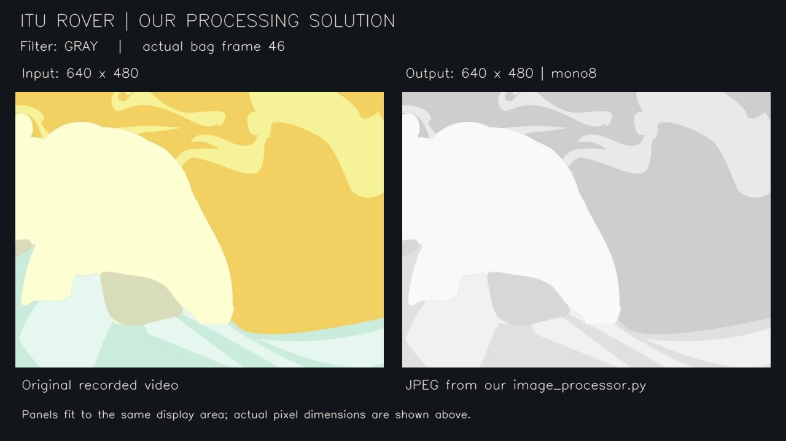
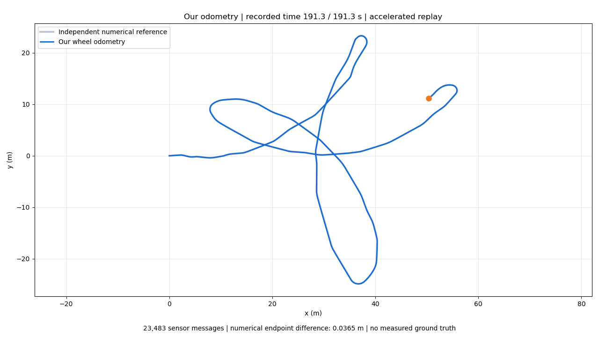
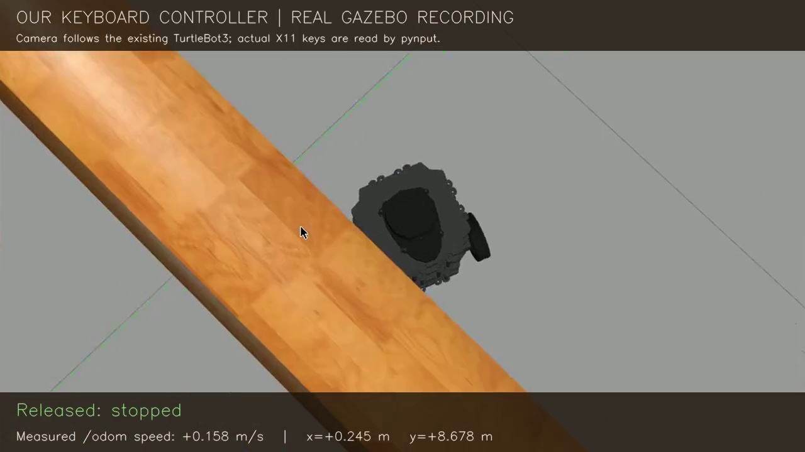
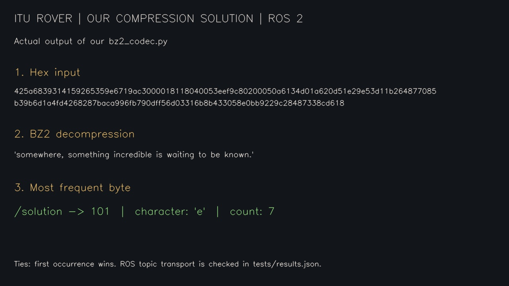
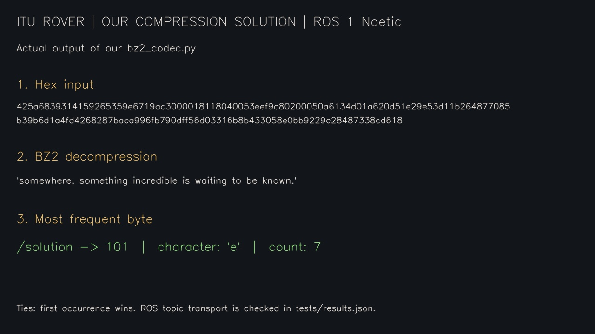

# İTÜ Rover çözümleri ve kendi çıktı videolarımız

Beş ödev ayrı klasörlerdedir. Her klasörde çözüm kodu, çalıştırma yönergesi,
bağımsız testler ve `media/solution` altında kendi sonuçlarımız bulunur.
Obstacle avoidance bu pakete dahil değildir.

**Videoları topluca izlemek için:** depoyu ZIP olarak indirip çıkarın ve
`SHOWCASE.html` dosyasını tarayıcıda açın. GitHub'dan da aşağıdaki video
bağlantılarıyla tek tek görüntüleyebilir veya indirebilirsiniz.

73 birim testi Jazzy ve Humble'da geçti. Bu bir test başarı oranıdır;
gerçek araç konumu için yüzde doğruluk ölçümü değildir. Odometry'nin yön
modeli düzeltildi: bu kayıt için açık Q14 uyumluluk profiliyle dörtgen rota
üretilir. Canlı sensörlerde geçersiz yönelimi reddeden strict varsayılanı korunur.
[9 Kasım düzeltmesi ve kapsam](validation/ODOMETRY_CORRECTION.md).

## Görüntü işleme

4 filtre; 48 gerçek bag çıktısı kontrolü; 8/8 birim testi.

[Bizim videomuz](iturover_processing_assignment_ros2/media/solution/solution_demo.mp4) · [Kod ve kullanım](iturover_processing_assignment_ros2/README.md) · [Ölçümler](iturover_processing_assignment_ros2/tests/results.json)

## Düzeltilmiş odometry

23.483 mesaj; teker hızı + normalize Q14 IMU yönü; gerçek ROS2 dörtgen rota; 27/27 test.

[Bizim videomuz](iturover_odometry_assignment_ros2/media/solution/solution_demo.mp4) · [Kod ve kullanım](iturover_odometry_assignment_ros2/README.md) · [Ölçümler](iturover_odometry_assignment_ros2/tests/results.json)

## Klavye / Gazebo

Gazebo hareketi; gerçek X11 testinde 60,05 s duruş; 10/10 test.

[Bizim videomuz](iturover_keyboard_control_assignment_ros2/media/solution/solution_demo.mp4) · [Kod ve kullanım](iturover_keyboard_control_assignment_ros2/README.md) · [Ölçümler](iturover_keyboard_control_assignment_ros2/tests/results.json)

## Compression ROS 2

14/14 test; gerçek DDS'de geçerli/geçersiz girdiler.

[Bizim videomuz](iturover_compression_assignment_ros2/media/solution/solution_demo.mp4) · [Kod ve kullanım](iturover_compression_assignment_ros2/README.md) · [Ölçümler](iturover_compression_assignment_ros2/tests/results.json)

## Compression ROS 1

14/14 test; kurulu Noetic paketinde 10 mesaj senaryosu.

[Bizim videomuz](iturover_compression_assignment/media/solution/solution_demo.mp4) · [Kod ve kullanım](iturover_compression_assignment/README.md) · [Ölçümler](iturover_compression_assignment/tests/results.json)

## Çalıştırma ve doğrulama

[Ayrıntılı test raporu](validation/RESULTS.md) sınanan durumları, ölçümleri ve
tekrar çalıştırma komutlarını açıklar. Görüntü ve odometry videoları gerçek
bag verilerinden; compression videoları kendi Python çözüm fonksiyonlarının
sonuçlarından üretilmiştir. Klavye videosunda robot yakın planda görünür;
X11 tuş olaylarını gerçek pynput dinleyicisi okur. Robot model görsellerinin
Gazebo model yolundan bulunması düzeltilmiştir.

## Erişim

Bu depo private'dır. WhatsApp'tan link göndermek erişim vermez; alıcının
GitHub hesabını Settings → Collaborators bölümünden davet etmek gerekir.
GitHub'da yalnız linki bilenlerin erişebildiği bir repo görünürlüğü yoktur.

## Kaynaklar

Ödev iskeletleri ve bag verileri [İTÜ Rover](https://github.com/itu-rover)
depolarından alınmıştır. Her alt klasörde orijinal README ve kaynak dosyaları
korunur. Önceki çözüm dalları İTÜ Rover depolarından kaldırılmıştır.
