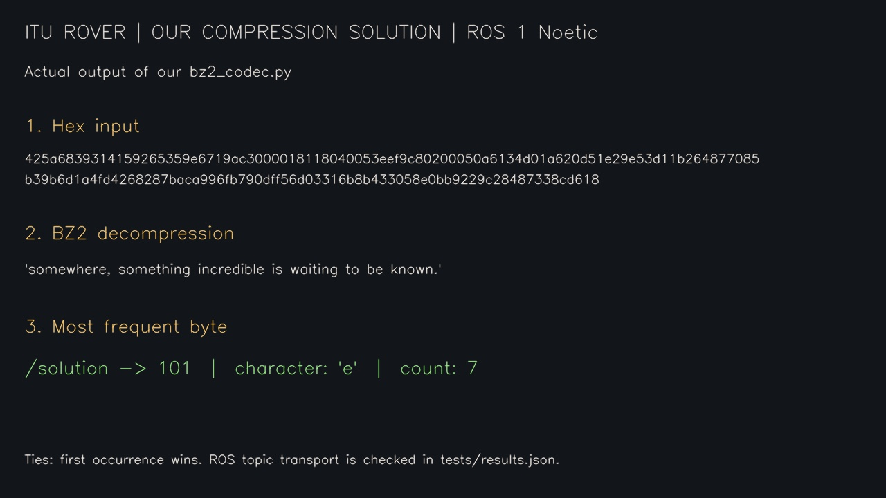

# Bizim compression sonucumuz (ROS 1 Noetic)

[solution_demo.mp4](solution_demo.mp4) çözüm fonksiyonumuz gerçekten çalıştırılarak üretilmiştir. Örnek metin, ödevdeki abcdddef, eşitlik ve bozuk hex durumlarını gösterir. Bu video Python hesap sonucunu sunar; ROS topic doğrulaması tests/results.json dosyasındadır.

