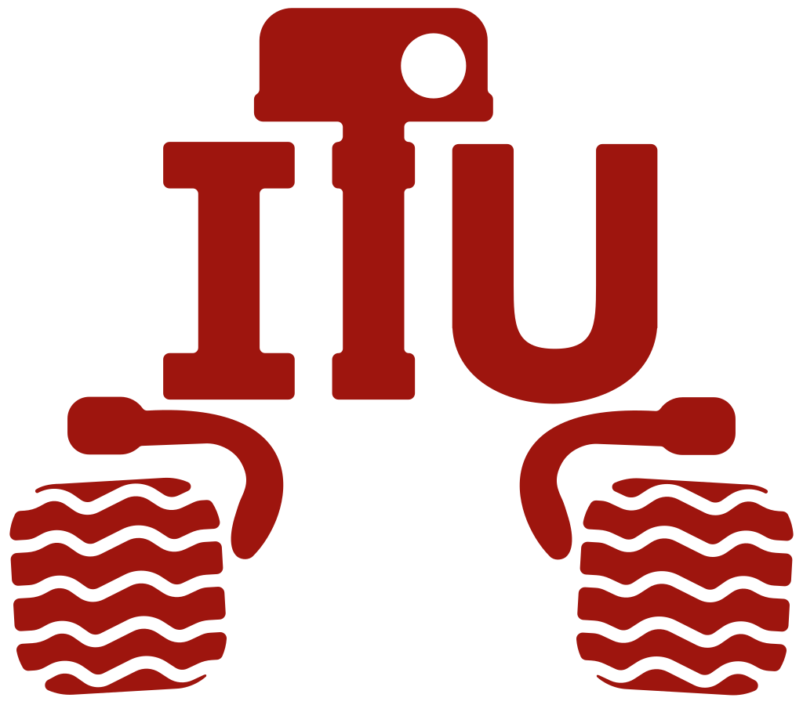

<div align="center">


</div>

# Kurulum
* Bilgisayarınıza Ubuntu 22.04 kurmalısınız.
* Ubuntu 22.04'e ROS 2 Humble kurmalısınız. [Ubuntu install of ROS 2 Humble](https://docs.ros.org/en/humble/Installation/Ubuntu-Install-Debs.html)
* Temel ROS 2 bilgileri için: [ROS 2 Tutorials](https://docs.ros.org/en/humble/Tutorials.html)

### Paket Kurulumu

Bir workspace oluşturun ve paketi derleyin:

```bash
mkdir -p ~/rover_ws/src
cd ~/rover_ws/src
git clone https://github.com/itu-rover/iturover_compression_assignment_ros2
cd ~/rover_ws
colcon build
source install/setup.bash
```

Verilen publisher node'u çalıştırmak için:

```bash
ros2 run iturover_compression_assignment bz2_publisher.py
```

Çözüm node'unu ayrı bir terminalde başlatın:

```bash
ros2 run iturover_compression_assignment bz2_solution.py
```

Node, `/bz2_message` üzerindeki hex verisini BZ2 ile açar ve en sık görülen
baytın sayısal ASCII değerini `std_msgs/msg/Char` olarak `/solution` topic'ine
yayar. Sonucu kontrol etmek için `ros2 topic echo /solution` kullanabilirsiniz.

Eşit sayıda geçen baytlar arasında metinde ilk görülen seçilir: `baba` → 98.
`Char` bir bayt taşıdığı için 128–255 değerleri de korunur; Unicode karakter
sayımı yapılmaz. Boş içerik, geçersiz hex, kesilmiş/bozuk BZ2 ve sondaki çöp
veri sonuç üretmez. Sonraki geçerli mesaj normal işlenir. Birleştirilmiş BZ2
akışları desteklenir. Varsayılan sınırlar `max_compressed_bytes=1048576` ve
`max_decoded_bytes=4194304`; açma işlemi çıktı sınırıyla yapılır. Aynı cevap
her mesajda yayınlanır, bilgi logu yalnız cevap değiştiğinde yazılır.

# ITU Rover Compression Assignment
Size verdiğimiz **bz2_node** isimli node, bz2 (Burrows–Wheeler) algoritmasıyla sıkıştırılmış bir veriyi on altılı sayı sisteminde (hexadecimal) `/bz2_message` topic'i üzerinde yayınlamaktadır.


Sırasıyla,
* Yayınlanan topic'i dinlemeniz,
* Verinin sıkıştırılmamış hâlindeki en çok tekrar eden karakteri bulun.
* Daha sonra bu karakterin ASCII tablosunda denk geldiği sayıyı [std_msgs/msg/Char](https://docs.ros2.org/humble/api/std_msgs/msg/Char.html) mesaj türünde **"/solution"** isimli topic'e publishlemeniz beklenmektedir.

### Örnek:

Size verdiğimiz scriptte verinin sıkıştırılmamış hâli "abcdddef" olsun.

"abcdddef" bz2 algoritması vasıtasıyla compress edildiğinde çıktı `b"BZh91AY&SY\x13\x84\x11\xdd\x00\x00\x00\x01\x00?\x00 \x00!\x80\x0c\x03')\xdc]\xc9\x14\xe1B@N\x10Gt"` oluyor. Bu verinin on altılı sayı sisteminde karşılığı ise `"425a6839314159265359138411dd00000001003f00200021800c032729dc5dc914e142404e104774"` oluyor. `/bz2_message` topic'i üzerinden en son elde ettiğimiz on altılı sayı sistemi formunda [std_msgs/msg/String](https://docs.ros2.org/humble/api/std_msgs/msg/String.html) türünde yayınlanıyor.

Sizden yapmanızı istediğimiz şey, `"425a6839314159265359138411dd00000001003f00200021800c032729dc5dc914e142404e104774"` ifadesini sıkıştırılmamış hâline (verdiğimiz örnekte "abcdddef") getirmek. Ardından bu verinin en çok tekrar eden karakterini (örneğimizde 'd') bulmanız ve bu karakterin ascii tablosundaki karşılığını (Örn: d karakteri için 100) bulup [std_msgs/msg/Char](https://docs.ros2.org/humble/api/std_msgs/msg/Char.html) mesaj tipinde publishlemeniz istenmektedir.

## ASCII Table


## Çözüm testleri

Bu depoyu bağımsız test etmek için [tests/README.md](tests/README.md) dosyasına bakın.
Ölçümler [tests/results.json](tests/results.json) içindedir.

## Bizim çözümümüzün görüntüsü

[Önizleme ve açıklama](media/solution/README.md) · [Çözüm videosu](media/solution/solution_demo.mp4)
