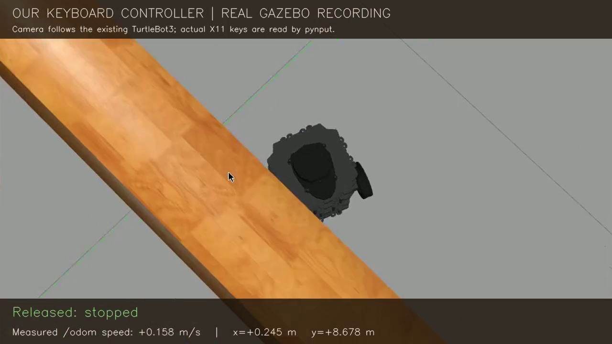

# Robotun göründüğü yeni klavye kontrolü kaydı

[solution_demo.mp4](solution_demo.mp4), gerçek Gazebo ekran kaydının yalnız
viewport'u kırpılıp tuş ve ölçülen hız etiketleri eklenmiş halidir. Robot
videoya sonradan çizilmemiştir. Kamera, gerçek TurtleBot3 görselinin simülasyondaki
konumunu takip eden yalnızca çizim tarafında çalışan bir istemci eklentisiyle
yakın planda tutulur. Bu eklenti fizik veya robot komutlarını değiştirmez.

X11/XTEST ile üretilen W, A ve S tuşlarını gerçek pynput dinleyicisi okur;
çözüm node'u /cmd_vel yayınlar. İleri, ileri+sol, tuş bırakınca duruş, geri ve
son duruş sırasıyla gösterilir. Video kısa gösterimdir; 60 saniye kuralının
ayrı gerçek zaman testi tests/results.json içindedir.

Ham kayıt: [gazebo_viewport.mp4](gazebo_viewport.mp4).
Ölçümler: [gazebo_telemetry.json](gazebo_telemetry.json).
Ödevin corridor dünyası ve TurtleBot3 Burger kullanılır. Eksik dekoratif
mesh görselleri gizlidir; çarpışma geometrisi korunur.

