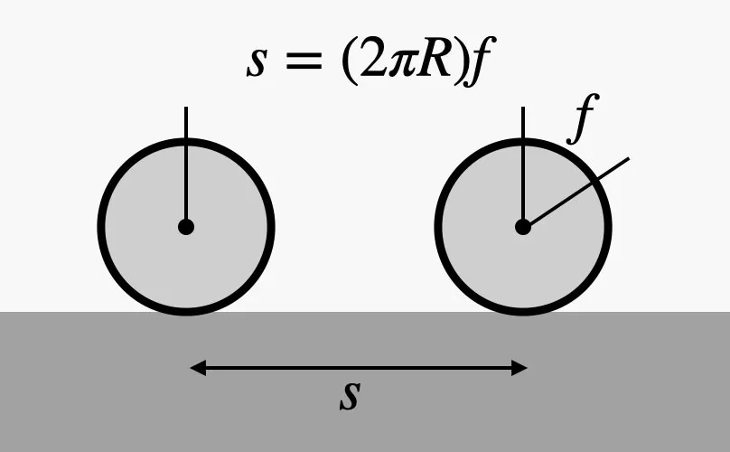
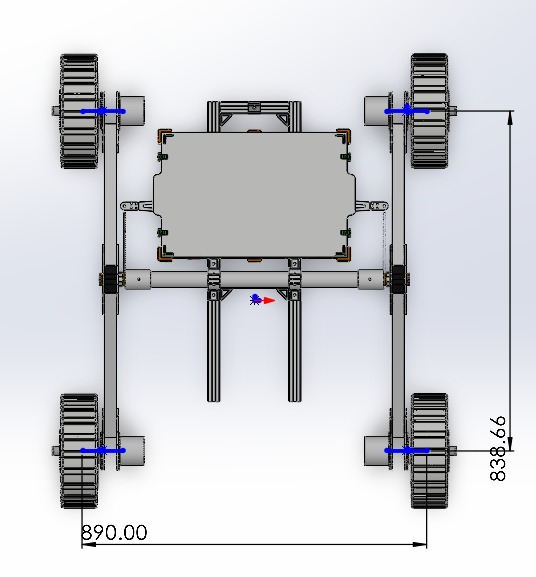
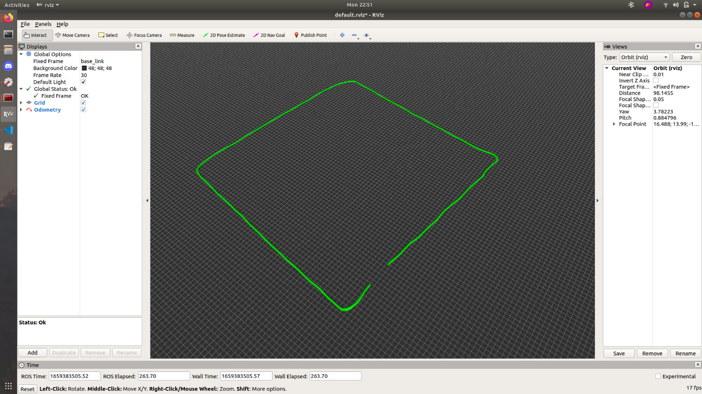

<div align="center">

</div>

# ITU Rover Odometry Assignment

Yukarıda gördüğünüz gezegen gezgini aracımızı Elektrik Elektronik Fakültesi'nde bir gezintiye çıkardık. Sizlere tahsis ettiğimiz **rosbag** dosyasında araç, gezintisini sürdürürken geri bildirim olarak aldığı teker hızı ve IMU verileri yer alıyor. Tekerleklerin yarıçapı ve hızları gibi bilgiler bilindiği için aracın başlangıç konumuna göre ne kadar ilerlediğini tahmin etmek mümkün.

<div align="center">

</div>


Ödevle ilgili daha fazla bilgiye ve yardımcı olacak kaynaklara aşağıdan ulaşabilirsiniz.

# Kurulum

Bir workspace oluşturun ve bu paketi klonlayıp derleyin.

```bash
mkdir -p ~/rover_ws/src
cd ~/rover_ws/src
git clone https://github.com/itu-rover/iturover_odometry_assignment_ros2.git
cd ~/rover_ws
colcon build
source install/setup.bash
```

# Kullanım

ROS 2 bag dosyasını çalıştırın.

```bash
ros2 launch iturover_odometry_assignment rosbag.launch.py
```

Bu launch dosyası rosbag ile birlikte `odometry.py` node'unu başlatır. Varsayılan
hesap teker odometrisidir: her taraftaki iki RPM değeri ortalanır; teker yarıçapı
0.135 m, teker iz genişliği çizimdeki 890 mm'dir. Hızlar `v=(vR+vL)/2` ve
`w=(vR-vL)/0.890` ile hesaplanır; dönüşte yay boyunca konum güncellenir.
Node `/odom` ve `odom -> base_link` TF yayınlar. Zaman rosbag'in `/clock`
yayınından alınır. Yeni teker hızı, önceki zaman aralığına uygulanmaz.

Yalnızca odometri node'unu çalıştırmak için:

```bash
ros2 run iturover_odometry_assignment odometry.py
```

RViz2'de Fixed Frame alanını `odom` yapıp `/odom` için Odometry gösterimi ekleyin.
Sağ ve sol sensörlerden tam iki sonlu RPM değeri gerekir. Gerekli sensör verisi
0.5 saniyeden eskiyse konum sabit tutulur ve sıfır hız yayınlanır. Saat geri
sarıldığında konum ve sensör geçmişi sıfırlanır; bag tekrarı mesafeyi biriktirmez.

Bag'deki 21.571 IMU mesajında `orientation_covariance[0] == -1` bulunuyor;
ROS mesaj sözleşmesine göre yönelim kullanılamaz. Ayrıca quaternion değerleri
birim uzunlukta değil. Bu nedenle verilen bag için varsayılan `heading_source=wheel`
kullanılır. Geçerli IMU verisiyle `--ros-args -p heading_source:=imu` seçilebilir;
bu mod quaternion'u normalize eder ve ilk geçerli yaw değerini başlangıç yönü alır.

Başlangıç parametreleri: `wheel_radius=0.135`, `wheel_separation=0.890`,
`sensor_timeout=0.5`, `max_dt=0.5`, `publish_tf=true`, `odom_frame=odom`,
`base_frame=base_link`. Kovaryans değerleri yaklaşık başlangıç değerleridir,
sensör kalibrasyonundan çıkarılmamıştır. Teker kayması ve etkin iz genişliği
gerçek araçta konum hatası oluşturabilir; bu bag gerçek konum referansı sağlamaz.

Yukarıdaki komutu yazdıktan sonra gezintimiz sırasında araçta gerçekleşen veri transferlerinin aynıları bilgisayarınızda da gerçekleşecektir.

Aşağıdaki komut ile rosbag'in doğru bir şekilde çalışıp çalışmadığını anlayabilirsiniz:

```bash
ros2 topic echo /drive_system_left_motors_feedbacks
```

## Rosbag içeriği
Rosbag aşağıdaki topiclerden mesajlar içermektedir:

**/drive_system_left_motors_feedbacks**

Bu topicte 2 elemanlı bir [std_msgs/msg/Float64MultiArray](https://docs.ros2.org/humble/api/std_msgs/msg/Float64MultiArray.html) türünde veri bulunmaktadır.
array'deki elemanlar sırasıyla sol ön ve sol arka tekerleğin dakikadaki dönüş sayılarıdır.

`Örneğin; [30, 40] verisi sol ön tekerleğin 30 RPM, sol arka tekerleğin 40 RPM hızda döndüğünü gösterir.`

**/drive_system_right_motors_feedbacks**

Bu topicte 2 elemanlı bir [std_msgs/msg/Float64MultiArray](https://docs.ros2.org/humble/api/std_msgs/msg/Float64MultiArray.html) türünde veri bulunmaktadır.
array'deki elemanlar sırasıyla sağ ön ve sağ arka tekerleğin dakikadaki dönüş sayılarıdır.

`Örneğin; [30, 40] verisi sağ ön tekerleğin 30 RPM, sağ arka tekerleğin 40 RPM hızda döndüğünü gösterir.`

**/imu1/data**

Bu topicte aracın üzerindeki imudan gelen [sensor_msgs/msg/Imu](https://docs.ros2.org/humble/api/sensor_msgs/msg/Imu.html) sensör verilerini bulabilirsiniz. Teker odometrisi için gerekli olmasa da dilerseniz bu veriyi de kullanabilirsiniz.

IMU verisindeki oryantasyon bilgisi quaternion olarak gelmektedir. (x,y,z,w) Oryantasyon bilgisini kullanabilmek için quaternion olan oryantasyon bilgisini euler (roll,pitch,yaw) şekline çevirmeniz gerekebilir.

**Bknz.**
* https://docs.ros.org/en/humble/Tutorials/Intermediate/Tf2/Quaternion-Fundamentals.html
* `tf_transformations` (`euler_from_quaternion`) veya `scipy.spatial.transform.Rotation`


# Gerekli bilgiler
Aşağıdaki ölçütlere ek olarak aracımızın teker yarıçapı 135mm'dir.


<div align="center">

</div>


# Ekran görüntüleri


Ödevi tamamladığınızda göreceğiniz görüntü aşağıdaki gibidir.

<div align="center">

</div>

# Ayrıca bakınız

* https://www.cs.columbia.edu/~allen/F17/NOTES/icckinematics.pdf
* https://www.cs.cmu.edu/~16311/s07/labs/NXTLabs/Lab%203.html
* https://www.youtube.com/watch?v=aE7RQNhwnPQ
* https://www.youtube.com/watch?v=XbXhA4k7Ur8

## Çözüm testleri

Bu depoyu bağımsız test etmek için [tests/README.md](tests/README.md) dosyasına bakın.
Ölçümler [tests/results.json](tests/results.json) içindedir.

## Bizim çözümümüzün görüntüsü

[Önizleme ve açıklama](media/solution/README.md) · [Çözüm videosu](media/solution/solution_demo.mp4)
