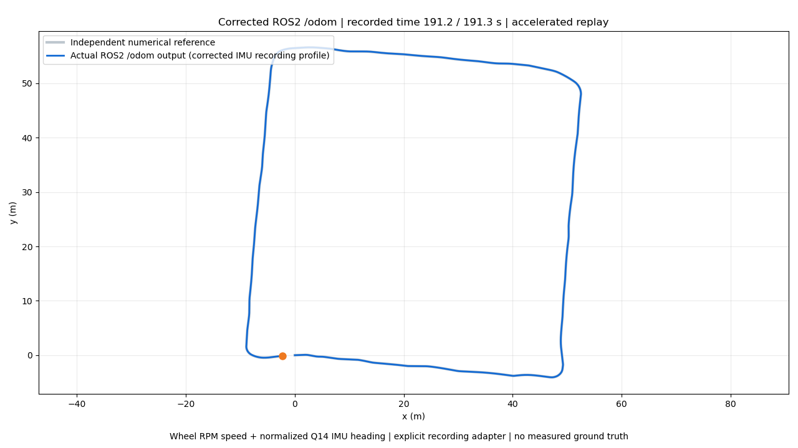
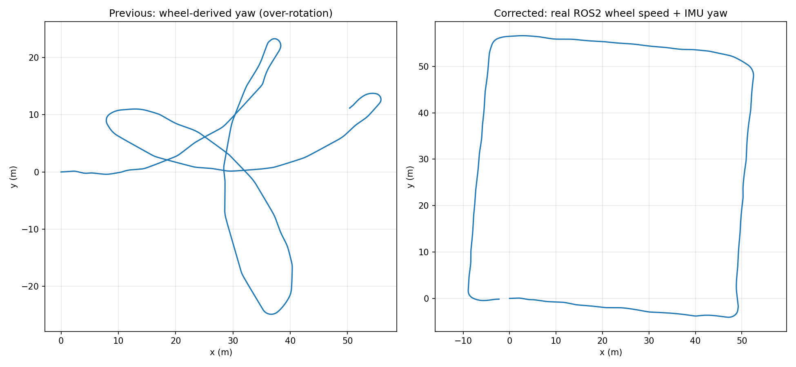

# Düzeltilmiş odometry sonucumuz

[solution_demo.mp4](solution_demo.mp4) tam bag oynatılırken gerçek ROS2 node'undan kaydedilen `/odom` mesajlarının hızlandırılmış rota animasyonudur. Mavi çizgi canlı node çıktısı, gri çizgi aynı girdilerle bağımsız sayısal hesaptır.

İlerleme teker RPM'lerinden, yön normalize edilmiş IMU quaternion'undan gelir. Yalnız bu kayıt için açıkça `assignment_q14` uyumluluk modu seçilmiştir; metadata çelişkisi README'de açıklanır. Canlı sensör varsayılanı strict'tir. Kayıt yaklaşık 361° dönüş yapar; rota dörtgene döner. Gerçek konum referansı olmadığı için yüzde doğruluk iddiası yoktur.

