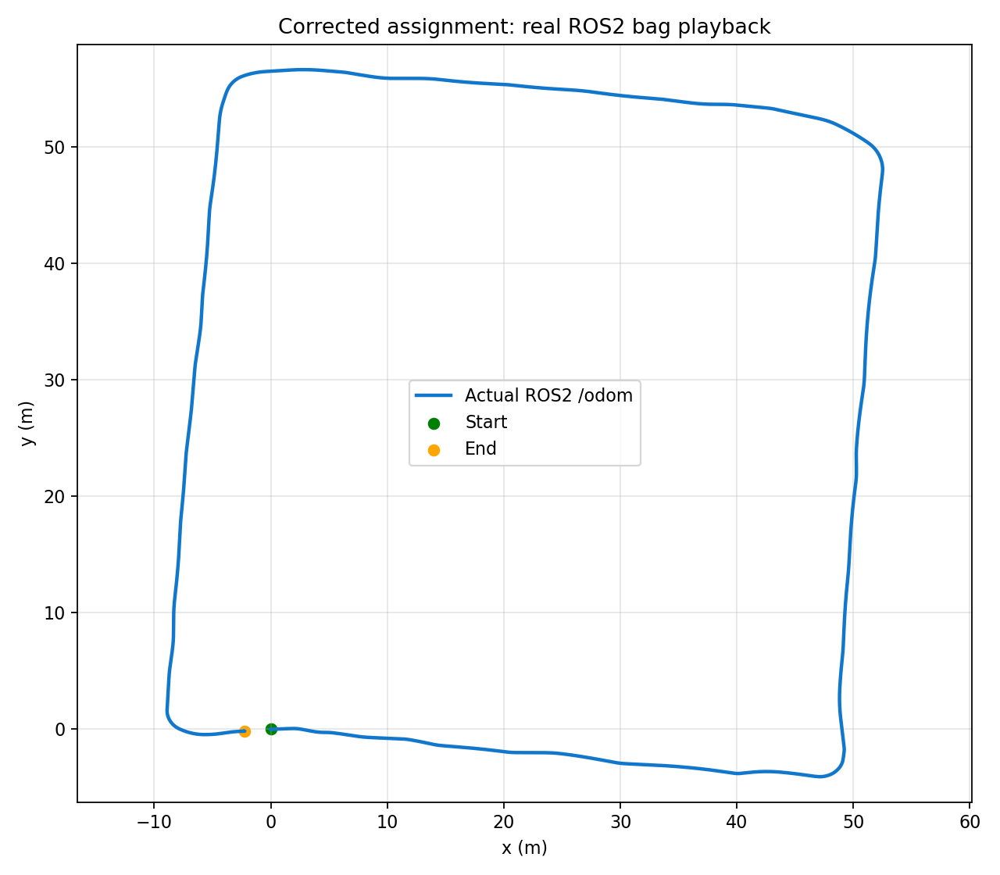

# Odometry düzeltmesi — 9 Kasım 2026

Eski döngülü rota düzeltildi. Verilen bag artık tekerlerden ilerleme hızı,
normalize edilmiş kayıtlı IMU'dan yön alınarak yaklaşık dörtgen rota üretir.
Bu sonuç yalnız çevrimdışı çizimle değil, tam bag oynatılırken gerçek ROS2
node'undan kaydedilen 2.392 `/odom` mesajıyla da doğrulandı.

## Model ve kayıt uyumluluğu

`vL = 2*pi*0.135*mean(RPM_L)/60`, sağ taraf için aynı dönüşüm ve
`v=(vL+vR)/2` kullanılır. Yaw ilk IMU ölçümüne göre sıfırlanır. Konum, hızın
yönü ve geçen zaman ile yay integrasyonu kullanılarak güncellenir.

Önceki ideal teker dönüş modeli bu kayıtta yaklaşık 939° dönüş üretmişti;
kayıtlı IMU yaklaşık 361° dönüş gösteriyor. Geometrik 0.890 m iz genişliğiyle
teker farkını doğrudan yön değişimi kabul etmek bu veri için uygun çıkmadı.
Referans görsele uysun diye çizgi, köşe, ölçek veya kapanış düzeltmesi eklenmedi.

Kayıt, quaternion bileşenlerini yaklaşık 16384 uzunluklu Q14 ölçeğinde
saklıyor ve buna rağmen yönelimi yok olarak işaretliyor. Bu çelişki genel
bir "bütün geçersiz mesajları kullan" seçeneğiyle geçilmez:

- Normal node varsayılanı `heading_source=imu`, `orientation_policy=strict`.
- Bu bag'in launch'ı açıkça `orientation_policy=assignment_q14` seçer ve uyarı verir.
- Geçersiz işaretli quaternion ancak uzunluğu 16384'ün %1 yakınındaysa adapte edilir.
- Sıfır, NaN, yanlış ölçek ve geçersiz işaretli birim quaternion reddedilir.
- Eski IMU/teker verisi konumu ilerletmez; saat geri sarılınca durum sıfırlanır.

Bu kayıt profili ölçek/metadata yorumunu açıkça belgeler. Canlı sensörlerde
strict kullanılmalı ve kaynak yayıncı geçerli, birim quaternion sağlamalıdır.

## Çalıştırılan kontroller

- 73 birim testi Jazzy ve Humble'da geçti; odometry'nin kendi 27 testi var.
- Analitik düz sürüş/çember, Q14 kare turu, hatalı ölçek, metadata reddi,
  stale veri, saat geri sarımı ve timer frekansı kontrolleri geçti.
- İki ROS2 dağıtımında gerçek topic kontrolü, teker hızları farklıyken sabit
  IMU yönünün aracı düz götürdüğünü ve 90° IMU dönüşünün doğru ekseni ürettiğini doğruladı.
- 23.483 kayıtlı mesaj iki kez işlenince aynı rota elde edildi.
- Tam bag gerçek ROS2 launch ile 4 kat hızda oynatıldı, `/odom` çıktısı kaydedildi.

Çevrimdışı sonuç: son konum yaklaşık (-2.2610, -0.1782) m, başlangıç-bitiş
uzaklığı 2.2680 m. Gerçek ROS2 çıktısının son konumu yaklaşık
(-2.2415, -0.1569) m; çevrimdışı hesapla farkı 0.02888 m'dir.
Bağımsız Euler integrasyonuyla çevrimdışı çözümün farkı 0.00397 m'dir.
Bu farklar **sayısal tutarlılıktır**, gerçek araç konum hatası değildir.
Başlangıç-bitiş farkı da otomatik olarak hata sayılamaz; ölçülmüş gerçek
konum serisi verilmemiştir ve rota yapay olarak kapatılmamıştır.

Humble'da da tam bag ayrıca oynatıldı: 2.393 gerçek `/odom` mesajı, son konum
yaklaşık (-2.2727, -0.1683) m, çevrimdışı sonuçla fark 0.01524 m ve toplam
dönüş 361.38° elde edildi. [Humble bag ölçümleri](humble/odometry_live_results.json).



[Güncellenen video](../iturover_odometry_assignment_ros2/media/solution/solution_demo.mp4)
gerçek ROS2 mesajlarından üretilen hızlandırılmış rota animasyonudur.
[Önce/sonra](../iturover_odometry_assignment_ros2/media/solution/before_after.png),
[ROS2 ölçümleri](odometry_live_results.json), [bag hesapları](bag_results.json).

## Tekrar çalıştırma

```bash
ros2 launch iturover_odometry_assignment rosbag.launch.py
# Hızlı gösterim:
ros2 launch iturover_odometry_assignment rosbag.launch.py rate:=4.0
```

RViz'de Fixed Frame `odom`, Odometry topic `/odom` seçilir.
Otomatik bag doğrulaması için derlenmiş workspace'i source edip ayrı bir
ROS domain'inde `python3 validation/odometry_live_bag.py` çalıştırılır.
