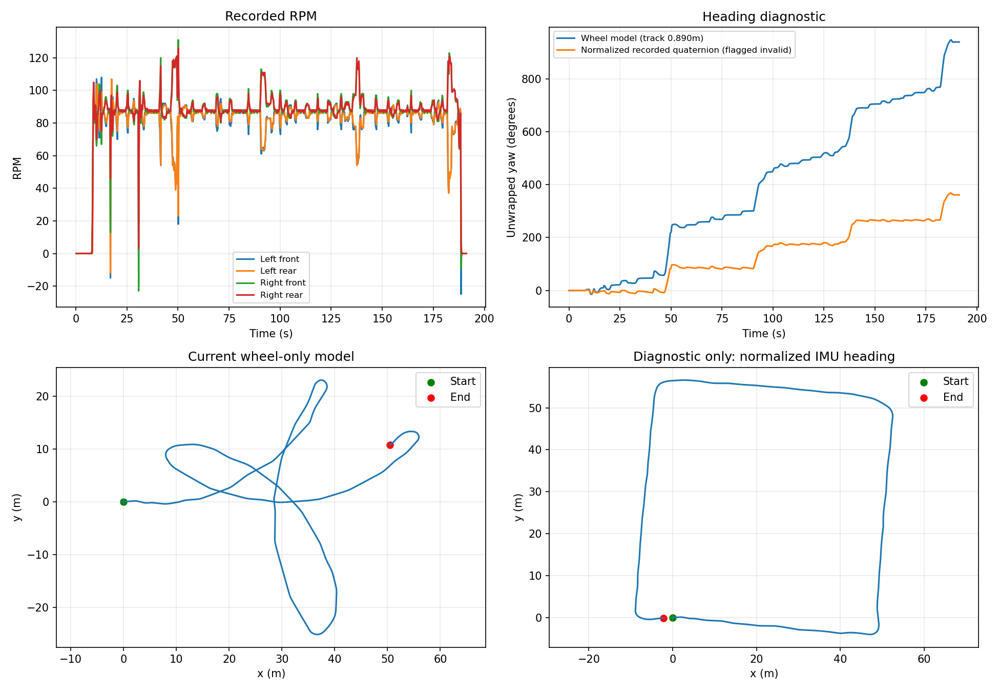

# Referans rota ile farkın incelenmesi — 9 Kasım 2026

Mevcut teker odometrisi matematik testlerini geçiyor ancak verilen bag'de
ödevin örnek görselindeki yaklaşık dörtgen rotayı üretmiyor. Önceki 3,65 cm
karşılaştırma aynı teker modeliyle yapılan iki integrasyonun sayısal farkıdır;
örnek rota veya gerçek konum doğrulaması değildir.

Temel model:

- Her tarafta ön/arka RPM ortalaması alınır.
- `vL = 2*pi*0.135*RPM_L/60`, sağ taraf için de aynı dönüşüm kullanılır.
- `v = (vR+vL)/2`, ideal diferansiyel modelde `omega=(vR-vL)/0.890`.
- Konum `dx=v*cos(theta)*dt`, `dy=v*sin(theta)*dt` ile veya yay integraliyle güncellenir.

`audit_odometry.py` aynı kayıt üzerinde mevcut modeli ve normalize edilmiş
kayıtlı quaternion yönelimini karşılaştırır. Bu inceleme kontrol modelini
veya güvenlik/validasyon varsayılanlarını değiştirmez.

| Gözlem | Sonuç |
|---|---:|
| Teker modelinin toplam açısı | 939,32 derece |
| Normalize quaternion ile tanısal toplam açı | 361,38 derece |
| Kayıtlı quaternion uzunluğu | 16383,28–16384,70 |
| IMU yönelim geçerlilik bayrağı | Kayıt boyunca `orientation_covariance[0] == -1` |

Sadece açı için normalize edilmiş quaternion kullanıldığında rota görsel olarak
yaklaşık dörtgen olur. Bu, görüntüdeki farkın basit kamera dönmesinden
kaynaklanmadığını gösterir. Teker hız farkından dönüş çıkaran ideal model
bu kayıt için fazla dönüş tahmin etmektedir. Kayma, etkin iz genişliği ve
sensör kalibrasyonu ayrıca incelenmelidir; bu ölçümler tek başına hangisinin
ana neden olduğunu kanıtlamaz.

IMU'nun yaklaşık 16384 ölçeğinde saklanması birim quaternion elde etmek için
normalizasyon gerektirdiğini gösterir; sensör tipi bu dosyalardan kesinleşmez.
ROS sözleşmesi `-1` bayrağıyla ilgili tahminin kullanılmamasını ister.
Dolayısıyla tanısal dörtgen rota otomatik olarak güvenilir yeni varsayılan
ilan edilemez. Kayıt üreticisinin bu bayrağı nasıl doldurduğu doğrulanmalı
veya kayda özel, açıkça belgelenmiş bir yönelim tercihi kullanılmalıdır.

Tekrar üretmek için ROS 2 ortamını source edip `python3 validation/audit_odometry.py`
çalıştırın. Sayısal sonuçlar [odometry_audit.json](odometry_audit.json) içindedir.
