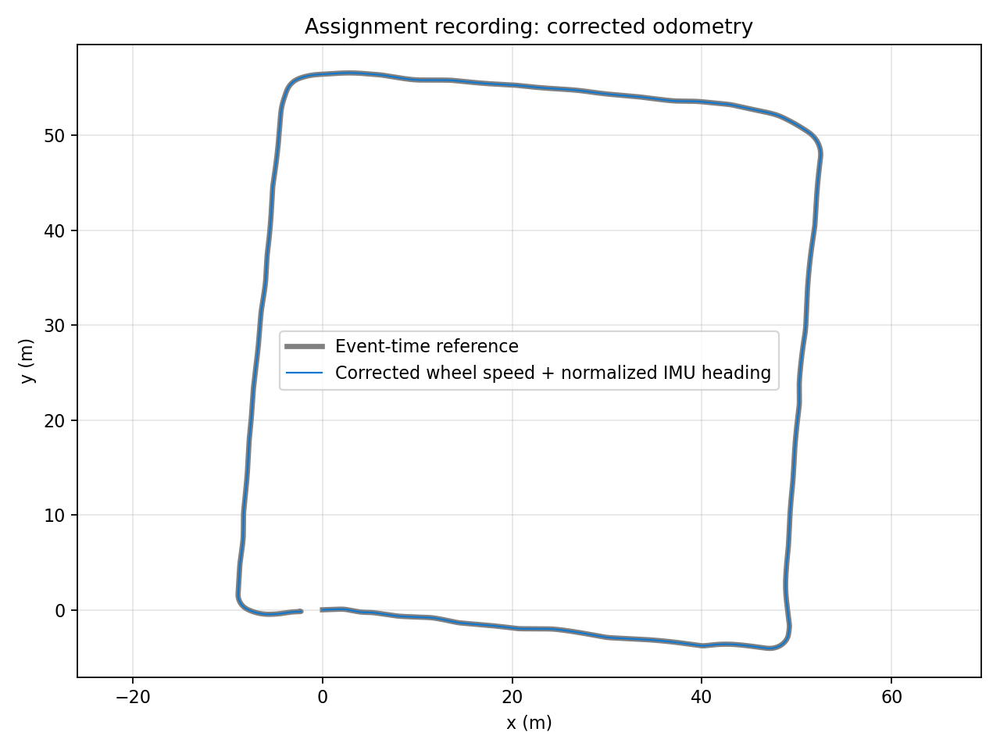

# Beş ödevin geliştirme ve doğrulama sonuçları

**9 Kasım güncellemesi:** Odometry yön modeli düzeltildi; teker hızı + normalize
Q14 kayıt yönelimi ile gerçek ROS2 çıktısı dörtgen rota üretiyor. 73 test Jazzy
ve Humble'da geçti. Güncel odometry açıklaması ve ölçümleri
[ODOMETRY_CORRECTION.md](ODOMETRY_CORRECTION.md) içindedir. Aşağıdaki 8 Kasım
odometry sayıları eski teker modelinin tarihsel ölçümleridir.

8 Kasım 2026 tarihinde beş çözüm geliştirildi ve çalıştırıldı. 65 birim testi
Jazzy ve Humble ortamlarında geçti. Dört ROS 2 paketinin derlemesi ve gerçek
topic üzerinden entegrasyon kontrolleri, ROS 1 paketinin Noetic derlemesi ve
mesajlaşma kontrolleri başarılı. Obstacle avoidance kapsam dışındadır.

| Ödev | Düzeltilen davranış | Ölçülen sonuç |
|---|---|---|
| Processing | RGB renk sırası, bozuk görüntüde çökme, önizleme ve QoS | 4 filtre; bag'den 12 kare üzerinde 48 çıktı kontrolü geçti |
| Odometry | Geçersiz IMU kullanımı, eski sensörlerle ilerleme, bag tekrarında birikme | 23.483 mesaj; bağımsız sayısal hesapla son konum farkı 0,03654 m |
| Keyboard | Yön değişimi logları, büyük harfler, karşıt tuşlar, süre ve kontrollü kapanış | Gazebo Classic'te 0,2584 m hareket; süre dolunca duruş ve node kapanışı |
| Compression ROS 2 | Boyut sınırı, bozuk/kesik akış, eşitlik davranışı | DDS üzerinden 4 geçerli + 5 geçersiz girdi; hatadan sonra toparlanma |
| Compression ROS 1 | Aynı çözüm kuralları, catkin yardımcı modül kurulumu | Noetic üzerinde 5 geçerli + 5 geçersiz girdi; hatadan sonra toparlanma |

## Doğruluk nasıl ölçüldü?

**Birim testleri:** 65 test metodu; alt senaryolar bu sayıya ayrıca eklenmedi.
İki compression uygulamasının her biri 200 sabit tohumlu rastgele bayt dizisinde
bağımsız sayım yöntemiyle karşılaştırıldı. Diğer kontroller: kesilmiş BZ2
akışlarının her kesim noktası, renklerin korunması, boyutlar, 16 tuş birleşimi,
tam 60 saniye sınırı, 10 m düz/geri sürüş, analitik çember, geçersiz quaternion,
sensör kesintisi, zaman sıçraması ve tekrar başlatma.

**Önce/sonra:** Düzenleme öncesi boş görüntü, RGB kırmızı renk ve eksik RPM
çifti kontrollerinin üçü de başarısızdı. Aynı üç kontrol düzenleme sonrası geçti.
[Önce](baseline_results.json), [sonra](regression_results.json).

**Odometry bag'i:** 191,31 saniyelik kayıt tamamen okundu. 21.571 IMU mesajının
tamamı yönelimi geçersiz olarak işaretliyor. Birim olmayan quaternion değerleri
de bulundu. Varsayılan çözüm bu nedenle teker odometrisi kullanır; teker
yarıçapı 0,135 m, iz genişliği depodaki [çizimden](../iturover_odometry_assignment_ros2/media/rover.jpeg)
0,890 m alınır. Geçerli IMU ile ayrıca `heading_source=imu` modu vardır.

Bağımsız referans, aynı teker hızlarını mesaj zamanlarında Euler yöntemiyle
entegre eder. Çözüm yay integrasyonu kullanır ve yeni hızın önceki zaman
aralığını değiştirmesini engeller. Referansın yol uzunluğu 221,285 m;
çözümün son konumu (50,3580; 11,1525) m, referansınki (50,3929; 11,1634) m.
Son konum farkı 3,65 cm'dir. Kayıt tekrarlandığında aynı sonuç elde edildi;
saat geriye sarıldığında konum ve sensör geçmişi sıfırlandı.



**Bu fark gerçek araç konum hatası değildir.** Ölçülmüş bir gerçek konum
serisi verilmediği için mutlak doğruluk yüzdesi çıkarılamaz. Teker kayması,
teker çapı ve etkin iz genişliği kalibrasyonu gerçek araçta ayrıca ölçülmelidir.
Yayınlanan kovaryanslar kalibrasyondan çıkarılmamış başlangıç değerleridir.

**Görüntü:** Bag'in farklı yerlerinden 12 kare seçilip dört filtre uygulandı.
Ham RGB ve gri çıktıları piksel düzeyinde referansla karşılaştırıldı; JPEG
çıktısında boyut ve sentetik ana renkler kontrol edildi. JPEG kayıplıdır.
Bu makinede medyan işlem süreleri yaklaşık 0,8–3,2 ms/kareydi; bunlar ROS
taşıma, çizim veya bütün video boyunca en kötü gecikme ölçümleri değildir.

**Gazebo:** Ödevin `obs_corridor_world` dünyası, TurtleBot3 Burger ve Gazebo
Classic/Humble kullanıldı. Kontrol node'una tuş olayları programla verildi;
60 saniye sınırı monoton saat enjeksiyonuyla hızlandırıldı. Gerçek simülasyon
odometrisi 0,2584 m ilerleme gösterdi. Duruştan sonraki 0,5 saniyede konum
değişimi 0,0000884 m idi; node sıfır komutları gönderdikten sonra kapandı.
Gazebo denemesi headless çalıştı. Son turda ayrıca Xvfb/XTEST üzerinden gerçek
X11 tuş olayları, gerçek monoton saatte 60 saniye ve kurulu pynput dinleyicisi
denendi: sıfır hız 60,04985 saniyede geldi, süreç 0 koduyla kapandı. SIGINT
ve SIGTERM duruş süreleri sırasıyla 0,05112 ve 0,05002 saniyeydi; ikisi de
0 koduyla kapandı. Bu test fiziksel klavye donanımını kapsamaz.

Bu son test Humble global executor'ında timer callback'i içinden shutdown
çağrısının kilitlendiğini ve dağıtımın pynput sürümünde `join(timeout=...)`
imzasının desteklenmediğini ortaya çıkardı. Kapanış ana döngüye taşındı,
join süresi konumsal argümanla verildi ve testler tekrar geçti. Noetic paketi
de bu turda `catkin_make install` sonrasında kurulum dizininden test edildi.

Her deponun `tests/` dizini artık bağımsız birim testlerini ve o ödeve ait
`results.json` ölçümlerini içerir. [Gerçek zamanlı klavye ölçümleri](keyboard_live_results.json).

## Yeniden çalıştırma

Windows PowerShell'den, bu çalışma klasöründe:

```powershell
wsl.exe -d Ubuntu-24.04 --cd "$PWD" -- bash validation/run_checks.sh
```

Bu komut dört ROS 2 paketini `/tmp/itu-rover-validation` altında derler;
birim, DDS, bag ve önce/sonra kontrollerini çalıştırır. Test süreçleri ayrı
ROS domain'i kullanır ve işlem sonunda kapanır. Jazzy'nin ROS/Python,
OpenCV ve NumPy bağımlılıkları gerekir; grafik için matplotlib isteğe bağlıdır.

Noetic ve Humble testleri için `run_ros1.sh` ve `run_humble.sh` konteyner
girişleri bulunur. Workspace `/assignments` altına salt okunur, sonuç dizini
`/results` altına yazılabilir bağlanır. Noetic için `ros:noetic-ros-base-focal`,
Humble için `osrf/ros:humble-desktop-full` kullanıldı. Gazebo testi ayrıca
Gazebo Classic ve TurtleBot3 paketlerini gerektirir; `gazebo_check.py` kendi
simülasyonunu başlatır ve temizler.

## Kanıt dosyaları ve sınırlar

- [Birim test çıktısı](unit_results.log), [Humble birim test çıktısı](humble/unit_results.log).
- [Jazzy ROS sonuçları](ros2_results.json), [Humble ROS sonuçları](humble/ros2_results.json).
- [Noetic sonuçları](noetic/ros1_results.json), [catkin derleme çıktısı](noetic/ros1_build.log).
- [Bag ölçümleri](bag_results.json), [Gazebo ölçümleri](gazebo_results.json).
- Bozuk mesajdan sonra node'ların çalışmaya devam etmesi doğrulandı.
- Görüntü piksel limiti decode sonrasında kontrol edilir; decode belleğine tam sınır koymaz.
- SIGKILL veya ağ kopması halinde son sıfır komutu garanti edilemez; gerçek robotta kontrolcü zaman aşımı gerekir.
- Başarılı testler sınanan durumlar için kanıttır; tüm olası girdiler için yüzde 100 doğruluk iddiası değildir.

IMU geçerlilik kuralı [ROS Imu mesaj tanımına](https://raw.githubusercontent.com/ros2/common_interfaces/humble/sensor_msgs/msg/Imu.msg)
dayanır. Sınırlı açma ve birleştirilmiş akış işleme davranışı
[Python BZ2Decompressor belgesine](https://docs.python.org/3/library/bz2.html#bz2.BZ2Decompressor)
göre uygulanmıştır.
